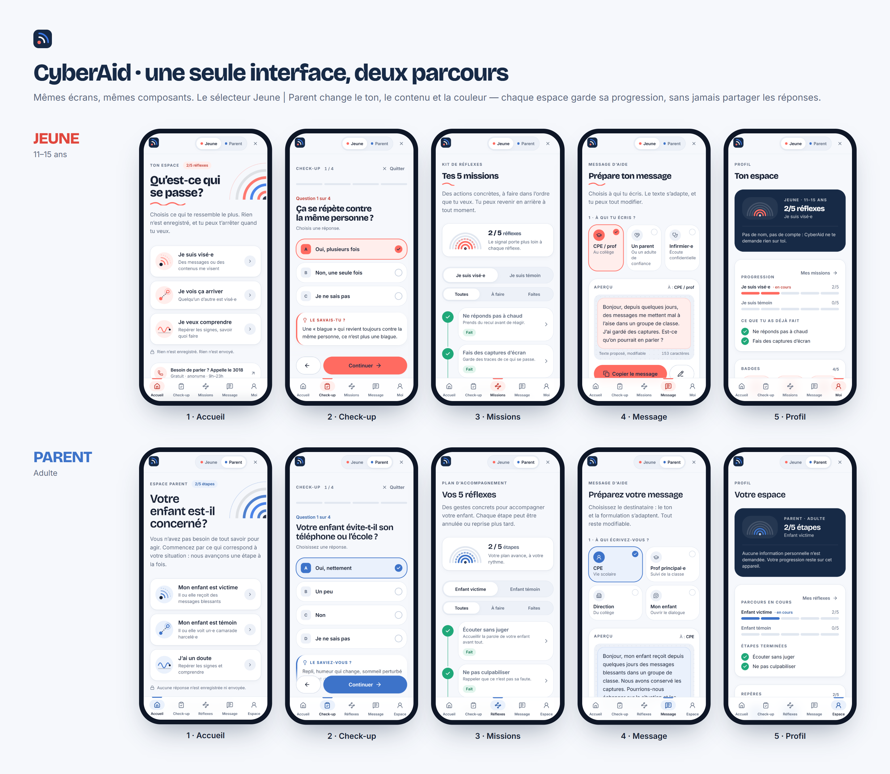
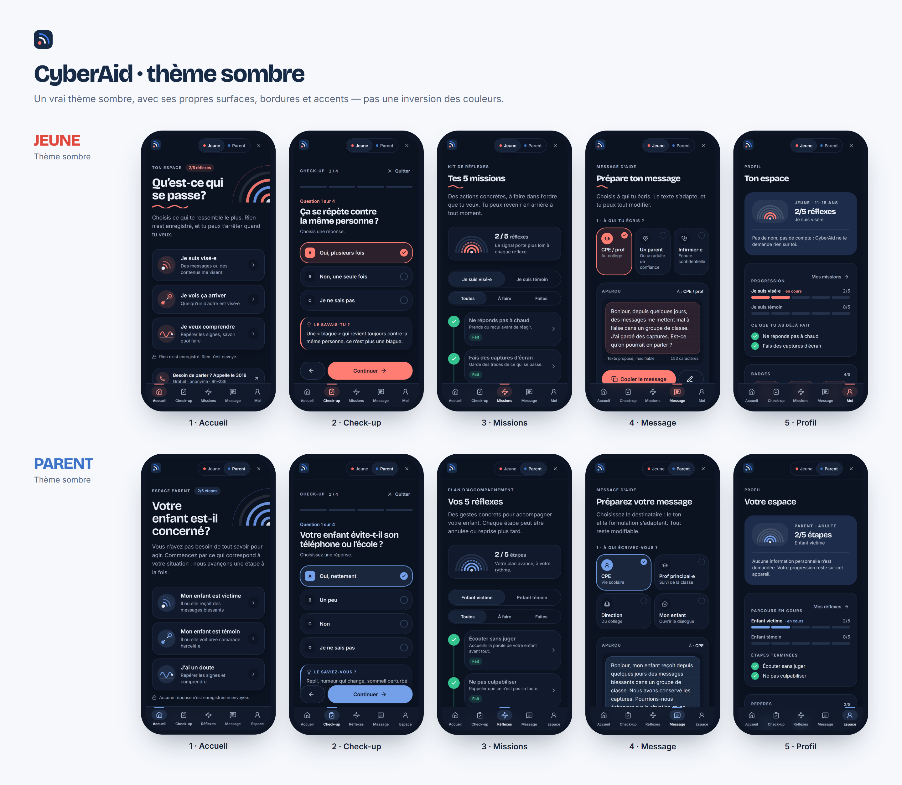

# CyberAid

**Comprendre, reprendre le contrôle, trouver du soutien face au cyberharcèlement.**

CyberAid est une application web responsive de prévention et d’accompagnement. Elle propose deux parcours sur un même socle de composants :

- **Jeune (11–15 ans)** : une expérience expressive et rassurante pour comprendre ce qu’on vit, adopter les bons réflexes et préparer une demande d’aide.
- **Parent** : une expérience calme et structurée pour repérer les signes, accompagner son enfant et échanger avec l’établissement.

> CyberAid ne décide pas à la place de l’utilisateur. Il l’aide à comprendre, à reprendre le contrôle et à trouver du soutien.



---

## Lancer le projet

### Prérequis

- [Node.js](https://nodejs.org/) **20 ou plus** (testé avec Node 24)
- npm (installé avec Node)

### Installation

```bash
git clone <url-du-depot>
cd CyberAid
npm install
```

### Développement

```bash
npm run dev
```

Puis ouvrir l’adresse affichée dans le terminal (par défaut **http://localhost:5173**).

### Build de production

```bash
npm run build     # vérification TypeScript + build dans dist/
npm run preview   # sert le build sur http://localhost:4173
```

| Commande          | Rôle                                              |
| ----------------- | ------------------------------------------------- |
| `npm run dev`     | Serveur de développement avec rechargement à chaud |
| `npm run build`   | Vérifie les types puis génère le build optimisé   |
| `npm run preview` | Prévisualise le build de production               |
| `npm run lint`    | Analyse statique du code (oxlint)                 |

---

## Fonctionnalités

| Écran           | Ce qu’on y fait                                                                                                                                 |
| --------------- | ----------------------------------------------------------------------------------------------------------------------------------------------- |
| **Accueil**     | Trois points d’entrée selon la situation, progression discrète, accès direct au 3018, fiche « Comprendre ».                                      |
| **Check-up**    | 4 questions maximum, choix uniques ou multiples, retour arrière, validation, conseil révélé après la réponse, résumé modifiable, orientation non diagnostique. |
| **Missions**    | 5 réflexes par situation (visé·e / témoin), sous-étapes à cocher, états *À faire / En cours / Fait*, annulation possible, progression « signal ». |
| **Message**     | Message d’aide adapté au destinataire et au contexte, éditable, copiable, partageable. **Aucun envoi automatique.**                              |
| **Profil**      | Progression, badges liés à des actions positives, thème clair/sombre/auto, rappels, confidentialité et effacement des données, ressources.         |

**Transversal :** bascule instantanée Jeune / Parent (la progression est conservée et isolée par profil), bouton **« Quitter vite »**, thème sombre dédié, animations respectant `prefers-reduced-motion`, navigation clavier complète, visée WCAG 2.2 AA.

### Responsive

- **Mobile (320–767 px)** : barre de navigation basse, actions à portée de pouce, safe areas iOS, navigation masquée quand le clavier est ouvert.
- **Tablette (768–1023 px)** : rail de navigation latéral et mises en page à deux colonnes.
- **Desktop (≥ 1024 px)** : barre latérale complète, missions en grille, aperçu du message fixé à droite.

---

## Stack technique

- [React 19](https://react.dev/) + [TypeScript](https://www.typescriptlang.org/)
- [Vite](https://vite.dev/)
- [Tailwind CSS v4](https://tailwindcss.com/) : design tokens en variables CSS
- [Motion](https://motion.dev/) : micro-interactions et transitions
- [Lucide](https://lucide.dev/) : icônes

## Structure

```
src/
├── index.css                 Design tokens « SIGNAL » : couleurs, typo, rayons, ombres, breakpoints, mouvement (clair + sombre)
├── data/                     Contenus sous forme de données
│   ├── types.ts
│   ├── young.ts              YoungProfile : textes, questions, missions, modèles de messages, badges
│   ├── parent.ts             ParentProfile
│   └── helpLines.ts          Numéros d’aide (3018, 119, 3020, 112)
├── state/AppState.tsx        État global : progression isolée par profil, thème, persistance minimale
├── lib/                      Routeur (hash), stockage, copie, sortie rapide, helpers de texte
├── components/
│   ├── ui/                   Button, SegmentedControl, Modal, Toast, Badge, Switch, EmptyState, ContactCard, ThemeSelector…
│   ├── layout/               TopBar, BottomNavigation, Sidebar, ProfileSwitcher, QuickExit
│   ├── art/                  Logo, SignalArcs (progression), illustrations abstraites
│   ├── checkup/              QuestionOption
│   ├── missions/             MissionItem, MissionCard, MissionSheet
│   └── message/              MessagePreview
└── screens/                  Home, Checkup, Missions, Message, Profile (chargés à la demande)
```

Les deux parcours partagent les mêmes composants : tout ce qui change (contenu, questions, missions, messages, badges) vient de `src/data/young.ts` et `src/data/parent.ts`, et la couleur d’accent vient de l’attribut `data-profile`.

## Confidentialité

- Les **réponses du check-up** et les **brouillons de message** ne sont **jamais** enregistrés.
- Seules la progression des missions et les préférences sont conservées en `localStorage` (désactivable et effaçable depuis le profil).
- Chaque profil a son propre état : l’espace Parent n’a **aucun accès** aux réponses de l’espace Jeune.
- Rien n’est envoyé : le message est copié, l’utilisateur choisit quand et à qui l’envoyer.
- « Quitter vite » remplace la page par une page neutre, sans retour possible.

## État du projet

Version de démonstration :

- pas de backend ni de compte ;
- les rappels sont simulés (aucune notification n’est programmée) ;
- les horaires des numéros d’aide sont indicatifs et doivent être vérifiés avant une mise en production.

## Captures

Des captures mobiles et desktop (clair et sombre) sont disponibles dans le dossier [`presentation/`](presentation/).


